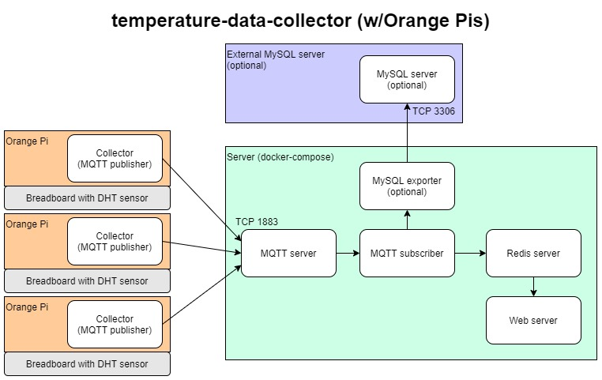
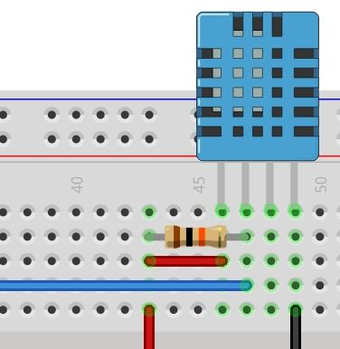

# wskit ⛅

wskit is an open-source, DIY **weather station kit** — lightweight sensor collectors and a self-hosted, Dockerized hub that streams live temperature, humidity, and barometric pressure data to a web dashboard. Air quality is on the roadmap.

## How it works

A **Collector** (ESP32 or Arduino MKR1000) reads an SHT45, BME280 and/or DHT22 sensor and publishes JSON readings over WiFi via MQTT. The **Server** (Docker Compose) receives those readings, stores them in MySQL, and serves a live dashboard.


(outdated diagram, similar concept)

---

## Getting Started

### Server

1. Clone this repository onto your Ubuntu/Debian server.

2. Open TCP ports on your firewall if needed:
   - `1883` — MQTT (collector → broker)
   - `8080` — Web dashboard

3. Run the setup script:
   ```bash
   bash server-setup.sh
   ```
   This will install Docker if needed, prompt for credentials, configure MySQL, and start all services.

4. Open the dashboard at `http://server_ip:8080`.

---

### Collector (ESP32 / Arduino MKR1000)

1. Wire up your sensor(s). The recommended setup is an SHT45 (temperature/humidity) plus a BME280 (pressure); a BME280 alone, or a DHT22, also work:
   - **SHT45** (I2C, e.g. the Adafruit breakout): VIN → 3.3V, GND → GND, SDA → GPIO 21, SCL → GPIO 22 on ESP32 (pins 11/12 on MKR1000). Leave 3Vo unconnected. It shares SDA/SCL with the BME280 (wire both to the same pins, or chain them with STEMMA QT cables). Detected automatically at address 0x44.
   - **BME280** (I2C): VIN → 3.3V, GND → GND, SDA → GPIO 21, SCL → GPIO 22 on ESP32 (pins 11/12 on MKR1000). Detected automatically at address 0x76 or 0x77.
   - **DHT22**: see the [DHT circuit diagram](#dht-circuit-diagram) below, with a 10kΩ pull-up resistor.

2. In the [Arduino IDE](https://www.arduino.cc/en/software/), select your board and install these libraries from the Library Manager:
   - [ArduinoMqttClient](https://github.com/arduino-libraries/ArduinoMqttClient)
   - [DHT22](https://github.com/dvarrel/DHT22)
   - [Adafruit SHT4x Library](https://github.com/adafruit/Adafruit_SHT4X)
   - [Adafruit BME280 Library](https://github.com/adafruit/Adafruit_BME280_Library), [Adafruit BME680 Library](https://github.com/adafruit/Adafruit_BME680), and [Adafruit BMP085 Library](https://github.com/adafruit/Adafruit-BMP085-Library) (all three are needed to compile, even if you only use one sensor)
   - [WiFi101](https://docs.arduino.cc/libraries/wifi101) *(MKR1000 only)*

3. Fill in your credentials in the `// CONFIGURE` section at the top of `collector-esp32/collector.ino`:
   ```cpp
   char ssid[] = "";            // your WiFi network name
   char pass[] = "";            // your WiFi password

   const char broker[] = "";    // your server's IP address
   const char mqttUser[] = "";  // MQTT_PUB_USER from .env  (default: publisher)
   const char mqttPass[] = "";  // MQTT_PUB_PASS from .env
   ```

   **Optional (ESP32, battery-powered): set a static IP.** The ESP32 deep sleeps between readings, and skipping DHCP cuts each wake from ~1.5–2 s to ~0.5 s, the biggest battery saving you can configure. Reserve the address on your router (or pick one outside its DHCP range), then set:
   ```cpp
   IPAddress staticIP(192, 168, 1, 50);  // the device's IP
   IPAddress gateway(192, 168, 1, 1);    // your router's IP
   ```
   Leave `staticIP` at `0.0.0.0` to use DHCP.

4. Flash `collector-esp32/collector.ino` to your board.

5. **Optional: battery power for portability (ESP32).** See [Battery power](#battery-power-optional) for parts and wiring. The ESP32 firmware deep sleeps between readings, so no code changes are needed. For the best battery life, also set the static IP from step 3.

<details>
<summary>Orange Pi collector (deprecated)</summary>

1. Build the circuit with a 10kΩ resistor and DHT sensor. The collector defaults to GPIO pin PA6.
2. Connect the Orange Pi to a network (use `nmtui` for WiFi; Ethernet for first-time setup).
3. Clone this repository on the Orange Pi and run `collector/collector.py`.

</details>

---

## Hardware

### Boards

| Board | Status | Notes |
|-------|--------|-------|
| [ESP32](https://www.espressif.com/en/products/socs/esp32) | **Active** | GPIO 4 (DHT22), GPIO 2 (LED) |
| [Arduino MKR1000](https://store-usa.arduino.cc/collections/boards/products/arduino-mkr1000-wifi-with-headers-mounted) | **Active** | A6 (DHT22), A5 (LED) |
| [Orange Pi Zero](https://a.co/d/6ztEWGC) | Deprecated | PA6 (DHT22); pyA20 library unmaintained |

### Sensors

| Sensor | Status | Notes |
|--------|--------|-------|
| [SHT45](https://www.adafruit.com/product/5665) | **Active** | Temp: ±0.1°C; Humidity: ±1%; I2C, sleeps between readings. Recommended for temp/humidity |
| [BME280](https://www.adafruit.com/product/2652) | **Active** | Temp, humidity, and barometric pressure over I2C |
| [DHT22](https://www.adafruit.com/product/385) | **Active** | Temp: −40–80°C ±0.5°C; Humidity: 0–100% ±2% |
| BME680 / BMP180 | Supported | Auto-detected in place of a BME280; BMP180 has no humidity |

Temperature and humidity come from the SHT45 if one is connected, otherwise from the DHT22. The pressure sensor supplies pressure, and takes over temperature/humidity if neither is connected or the reading fails.

### Miscellaneous parts

- Breadboard + jumper wires
- 10kΩ resistor (pull-up for DHT22 data line)
- Optional: status LED + 220Ω resistor

### Battery power (optional)

Run an ESP32 collector without a wall outlet. Battery power is supported on the ESP32 only; the MKR1000 can't deep sleep reliably, so it would drain a battery in hours.

| Part | Notes |
|------|-------|
| [Adafruit PowerBoost 1000C](https://www.adafruit.com/product/2465) | Boosts the battery to 5V and charges it over micro-USB while still powering the board (load-sharing) |
| 2× Samsung 30Q 18650 Li-ion cells, in parallel | 3000 mAh / 15A each, ~6000 mAh total |
| 2-cell 18650 holder (parallel) with a JST-PH 2-pin lead | Plugs into the PowerBoost's battery input |

**Wiring**
- 18650 pack → PowerBoost **BAT** (JST connector)
- PowerBoost **5V** → ESP32 **VIN** (5V pin)
- PowerBoost **GND** → ESP32 **GND**
- To charge, plug a USB power supply into the PowerBoost's micro-USB port. The collector keeps running while it charges.

**Battery safety**
- Only connect cells in parallel if they are the same model and at about the same voltage (charge both fully first). Otherwise the fuller cell dumps a large current into the emptier one.
- Use protected cells, or a holder with protection, if you can. The PowerBoost doesn't cut off the battery when it runs low.
- Unplug the battery before connecting the ESP32's own USB port to flash it, so the two power sources aren't connected at the same time.

**Expected battery life (estimated, not a long-term measurement)**

With deep sleep, a 60 s interval, and a static IP, the firmware itself uses only a few mA on average. Most of the remaining drain comes from hardware that stays on while the ESP32 sleeps: the dev board's voltage regulator and power LED, and the PowerBoost's boost converter and blue LED. Together these draw roughly 10–25 mA, which works out to about **1.5–2 weeks** per charge on 6000 mAh. Measured results from a full discharge test will replace this estimate.

To get more:
- Set a static IP (step 3 of the Collector setup). This made the biggest firmware-side difference in testing.
- Remove or cut the power LEDs on the dev board and the PowerBoost (saves a few mA).
- For months of runtime, use a low-power ESP32 board with a built-in LiPo charger (e.g. FireBeetle ESP32, Adafruit Feather ESP32 V2) instead of a DevKit + PowerBoost.

### Enclosures

Coming soon: a 3D-printable Stephenson screen design in PETG for outdoor placement.

### DHT circuit diagram



[Image source](https://osoyoo.com/2017/07/19/arduino-lesson-dht11-sensor/)

---

## Feature Roadmap

**v1.0**
- [x] Collector: ESP32 and Arduino MKR1000 firmware
- [x] Collector: Temperature and humidity sensor (DHT22)
- [x] Collector: Barometric pressure sensor (BME280)
- [x] Collector: JSON readings over MQTT, with the MAC address as the collector ID
- [x] Collector: Network resiliency (reconnects, auto-restart after repeated failures)
- [x] Collector: Batteries (ESP32 deep sleep between readings)
- [ ] Collector: WiFi credential management (no more hardcoded values)
- [ ] Collector: Model files for casing / outdoor placement
- [x] Server: Dockerized MQTT broker with authentication
- [x] Server: MySQL storage of all readings
- [x] Server: Live web dashboard with map view and dark mode
- [x] Server: History and Settings pages
- [x] Server: REST API for collectors and readings

**Future Ideas**
- [ ] Collector: Solar power
- [ ] Collector: AQI sensors
- [ ] Server: Graph/chart generation
- [ ] Server: Modular hub architecture (multiple locations)
- [ ] Particulate matter sensor support (Sensirion SPS30 or Plantower PMS5003)
